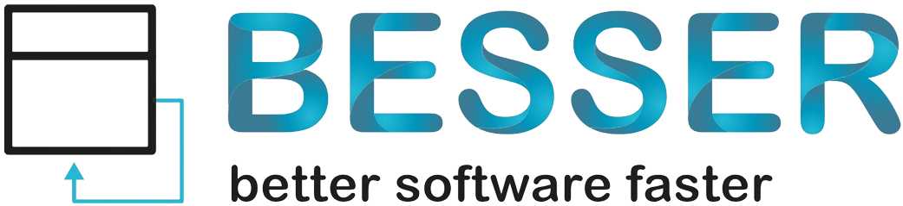
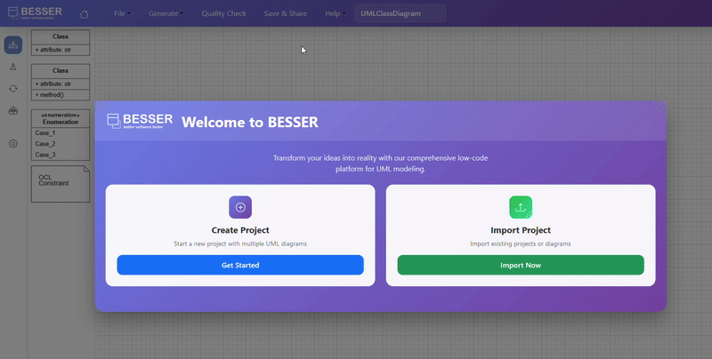

<div align="center">
  

  <h3>Draw a model. Get a working app.</h3>

  <p>BESSER is an open-source, model-driven low-code platform in Python.<br/>
  Design your app as a UML model — in the browser or in Python — and generate the code:<br/>
  FastAPI backends, React frontends, Django, Spring Boot, Flutter, databases, agents and more.</p>

  <p>
    <a href="https://editor.besser-pearl.org"><b>Try it in your browser</b></a> ·
    <a href="https://besser.readthedocs.io/en/latest/">Docs</a> ·
    <a href="https://github.com/BESSER-PEARL/BESSER-examples">Examples</a> ·
    <a href="https://github.com/BESSER-PEARL/Built-with-BESSER">Built with BESSER</a>
  </p>

[](https://pypi.org/project/besser/)
[](https://pypi.org/project/besser/)
[](https://pypi.org/project/besser/)
[](https://opensource.org/license/MIT)
[](https://github.com/BESSER-PEARL/BESSER/stargazers)

</div>

BESSER is a [low-modeling](https://modeling-languages.com/welcome-to-the-low-modeling-revolution/) [low-code](https://lowcode-book.com/) open-source platform. BESSER (Building bEtter Smart Software fastER) is funded thanks to an [FNR Pearl grant](https://modeling-languages.com/a-smart-low-code-platform-for-smart-software-in-luxembourg-goodbye-barcelona/) led by the [Luxembourg Institute of Science and Technology](https://www.list.lu/) with the participation of the [SnT/University of Luxembourg](https://www.uni.lu/snt-en/) and open to all your contributions!

<!-- TODO: replace with a new 20–30 s GIF: draw 2–3 classes → Generate → the running app in the browser. -->


## Quickstart

**No install:** open the [BESSER Web Modeling Editor](https://editor.besser-pearl.org), draw a class diagram (or describe your app and let the AI assistant draw it), and click **Generate**.

**In Python:**

    pip install besser

```python
from besser.BUML.metamodel.structural import DomainModel, Class, Property, StringType, IntegerType
from besser.generators.backend import BackendGenerator

book = Class(name="Book", attributes={Property(name="title", type=StringType),
                                      Property(name="pages", type=IntegerType)})
model = DomainModel(name="Library", types={book})

BackendGenerator(model, output_dir="library_api").generate()   # FastAPI + SQLAlchemy + Pydantic
```

    python library_api/main_api.py      # then open http://localhost:8000/docs

That's a working REST API with a database, CRUD endpoints and validation, generated from five lines of model.

**With your AI coding agent** (Claude Code, Cursor, Copilot, Cline, …): install the [BESSER Skills](https://github.com/BESSER-PEARL/besser-skills) and just ask, e.g. *"model a library with books and authors in BESSER and generate a FastAPI backend"*. The agent builds a correct B-UML model and runs the right generator for you.

    npx skills add BESSER-PEARL/besser-skills --all

## What you can generate

| You want… | BESSER generates |
|---|---|
| A full-stack web app | React frontend + FastAPI backend + database (`WebAppGenerator`) |
| A backend / REST API | FastAPI, SQLAlchemy, Pydantic · Spring Boot · Django · Supabase |
| A database | SQL DDL (PostgreSQL, MySQL, SQLite, …) · SQLAlchemy models |
| A mobile app | Flutter |
| Plain code & schemas | Python classes · Java classes · JSON Schema · RDF |
| Agents & chatbots | [BESSER Agentic Framework](https://github.com/BESSER-PEARL/BESSER-Agentic-Framework) agents from agent diagrams |
| ML & quantum | PyTorch · TensorFlow · Qiskit |
| Deployment | Docker Compose · Terraform |

See the [full list of generators](https://besser.readthedocs.io/en/latest/generators.html).

## Why model first?

- **Deterministic.** The same model always produces the same code. No prompt roulette for the parts that should be boring.
- **AI where templates stop.** The experimental [Spec-Driven Agent](https://besser.readthedocs.io/en/latest/spec_driven_agent/index.html) starts from the generated scaffold, lets an LLM add what the templates don't cover (auth, Docker, tests, other stacks), then validates the result. Where a free tier is configured, it runs without an API key.
- **The model stays the source of truth.** Change the model, regenerate, keep going. Class, object, state machine, agent, GUI, BPMN, neural network and quantum models all live in one project.

## Use BESSER from your AI coding agent

[BESSER Skills](https://github.com/BESSER-PEARL/besser-skills) and [UML Drawing](https://github.com/BESSER-PEARL/uml-drawing) package BESSER as [Agent Skills](https://agentskills.io) for Claude Code, Cursor, Copilot, Cline and others:

    npx skills add BESSER-PEARL/besser-skills --all
    npx skills add BESSER-PEARL/uml-drawing --all

## Contributing

Contributions are welcome: new generators, metamodels, bug fixes and docs. Start with [CONTRIBUTING.md](CONTRIBUTING.md) (local setup, tests) and the [Contributor Guide](https://besser.readthedocs.io/en/latest/contributor_guide.html). Look for [`good first issue`](https://github.com/BESSER-PEARL/BESSER/labels/good%20first%20issue) to get started.

If BESSER is useful to you, a ⭐ helps others find it.

## About

BESSER is built on [B-UML](https://besser.readthedocs.io/en/latest/buml_language.html), our Python-based interpretation of a "Universal Modeling Language", heavily inspired by UML.

- **Cite:** use the "Cite this repository" button (CITATION.cff).
- **Code of Conduct:** [CODE_OF_CONDUCT.md](CODE_OF_CONDUCT.md) · **Governance:** [GOVERNANCE.md](GOVERNANCE.md)
- **Contact:** [info@besser-pearl.org](mailto:info@besser-pearl.org) · [besser-pearl.org](https://besser-pearl.org) · [LinkedIn](https://www.linkedin.com/company/besser-pearl)
- **License:** [MIT](LICENSE.md)
