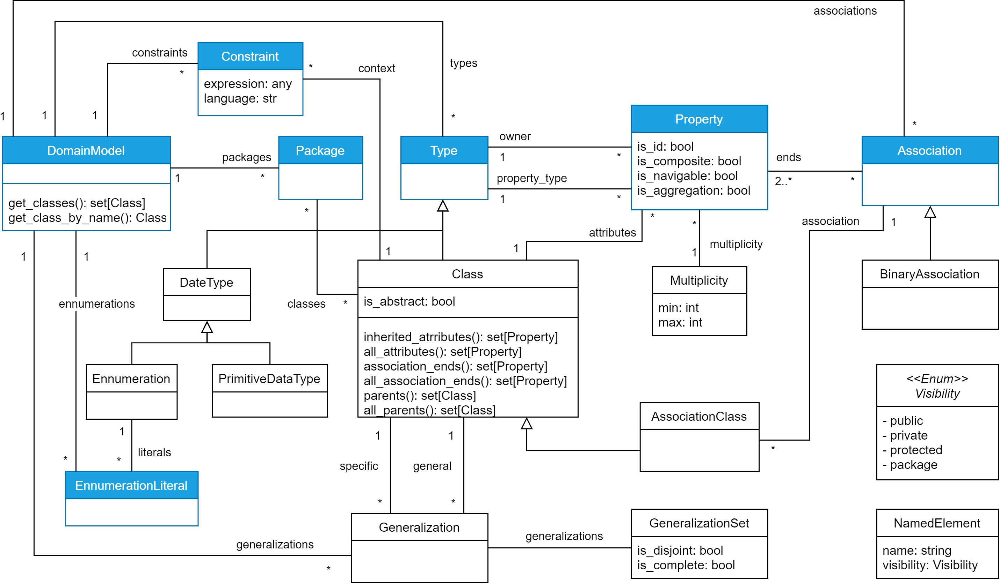

Structural model
================

The structural metamodel enables the specification of a domain model using the typical concepts of a class diagram. 
Elements such as *Classes*, *Properties*, *Associations*, and *Generalizations* can be instantiated to define the static 
structure of a system or application. While this metamodel is rooted in the UML specification, certain modifications and 
additions have been implemented to provide additional modeling capabilities. For instance, the *is_id* attribute 
has been introduced in the *Property* class to specify whether a property serves as an identifier for the instances of that
class, a common need in many code generation scenarios.

.. note::

  This figure contains only the main classes, attributes, and methods of the B-UML language. For a detailed 
  description please refer to the :doc:`API documentation <../../api>`.

Available Data Types
-----------------------

BESSER provides a comprehensive set of primitive data types for modeling. The available types include ``StringType``, 
``IntegerType``, ``FloatType``, ``BooleanType``, ``DateType``, ``TimeType``, ``DateTimeType``, ``TimeDeltaType`` 
and ``AnyType``. These types can be used to define properties and attributes in your structural models.

Method Implementations
----------------------

A ``Method`` can declare how its behavior is implemented through ``implementation_type``
(a ``MethodImplementationType``):

- ``NONE``: signature only (plain UML).
- ``CODE``: Python code stored in ``code``.
- ``BAL``: :doc:`BESSER Action Language <../../besser_action_language>` code stored in ``code``.
- ``STATE_MACHINE``: behavior defined by a :doc:`state machine <state_machine>` (``state_machine``).
- ``QUANTUM_CIRCUIT``: behavior defined by a :doc:`quantum circuit <quantum>` (``quantum_circuit``).
- ``NEURAL_NETWORK``: behavior defined by a :doc:`neural network <nn>` (``neural_network``);
  calling the method runs the NN.

When a behavior model is passed and ``implementation_type`` is omitted, the type is detected
automatically:

.. code-block:: python

    from besser.BUML.metamodel.nn import NN

    classifier = NN(name="ImageClassifier")
    predict = Method(name="predict", parameters=[Parameter(name="image", type=StringType)],
                     type=StringType, neural_network=classifier)
    assert predict.implementation_type == MethodImplementationType.NEURAL_NETWORK

In the web modeling editor, choose the implementation type in the method's popup, then pick
the linked diagram from the project (the NN option lists the project's NN diagrams).
The :doc:`Backend <../../generators/backend>` and :doc:`Web App <../../generators/full_web_app>`
generators turn NN-implemented methods into endpoints that run the network.

Association Navigability
------------------------

Each end of a ``BinaryAssociation`` is a ``Property`` whose ``is_navigable`` flag (``True`` by
default) states whether the associated class can be reached through that end. Both ends navigable
gives a bidirectional association; one non-navigable end gives a one-way association. Two rules apply:

- at least one end must be navigable;
- in a composition, the non-composite (part) end must be navigable. The composite (whole) end may be
  non-navigable.

Creating an association that breaks either rule raises a ``ValueError``. Ends changed afterwards
(e.g. ``end.is_navigable = False``) are reported as errors by ``DomainModel.validate()``.

.. code-block:: python

    from besser.BUML.metamodel.structural import (
        BinaryAssociation, Class, DomainModel, Multiplicity, Property,
    )

    order = Class(name="Order")
    line = Class(name="OrderLine")

    # Composition: Order (whole) owns its lines; the line -> order direction is not navigable
    order_end = Property(name="order", type=order, multiplicity=Multiplicity(1, 1),
                         is_composite=True, is_navigable=False)
    lines_end = Property(name="lines", type=line, multiplicity=Multiplicity(0, "*"))
    order_lines = BinaryAssociation(name="Order_Lines", ends={order_end, lines_end})

    model = DomainModel(name="Shop", types={order, line}, associations={order_lines})
    assert model.validate(raise_exception=False)["success"]

    lines_end.is_navigable = False  # now no end is navigable, and the part end of the composition is not
    for error in model.validate(raise_exception=False)["errors"]:
        print(error)
    # Association 'Order_Lines': at least one end must be navigable, but both 'lines' (OrderLine) and 'order' (Order) are non-navigable
    # Association 'Order_Lines': the non-composite end 'lines' (OrderLine) of a composition must be navigable

In the web modeling editor, every plain association is drawn as an *Association* whose ends each carry
a *Navigable* toggle; compositions and aggregations carry the same per-end toggle. Diagrams saved with the
former *Unidirectional* association type are loaded as an *Association* whose source end is not navigable.

Validation
----------

The structural metamodel performs validation at multiple levels:

- **Construction validation**: ``NamedElement.name`` setters reject ``None``, empty, or
  whitespace-only names and warn when the name is a Python keyword.
- **Attribute shadowing**: ``DomainModel.validate()`` checks that subclass attributes do not
  shadow inherited attributes from parent classes. A warning is raised if a subclass defines
  an attribute with the same name as one already present in a superclass.
- **Association navigability**: ``DomainModel.validate()`` reports binary associations with no
  navigable end, and compositions whose part end is not navigable (see
  `Association Navigability`_).

.. code-block:: python

    result = domain_model.validate()
    # result contains errors and warnings about the model structure

.. _structural-design-checks:

Design checks
~~~~~~~~~~~~~

``DomainModel.validate()`` also reports design mistakes that pass construction but
break, or degrade, the generated code. An **error** is a defect for every code
generator; a **warning** is legal UML that breaks a specific family of generators,
named in the message. The web editor's *Validate* shows both, and the Spec-Driven
Agent turns the fatal ones into blockers (see :ref:`spec-driven-model-contract`).
Each message says what is wrong, why it breaks generation, and how to fix it.

.. list-table::
   :header-rows: 1
   :widths: 30 10 60

   * - Check
     - Severity
     - Example message (abridged)
   * - Name that is not an identifier
     - error
     - Attribute '2nd_name' of class 'Item' is not a valid identifier: generated code uses the
       name as written, so it will not parse.
   * - Attribute typed by a type outside the model
     - error
     - Attribute 'color' of class 'Car' has type 'Color', which is not in the domain model.
   * - Mandatory creation cycle
     - warning
     - Mandatory creation cycle: Brand -> BrandURL -> Brand. … Relax one of the association
       ends in the cycle to an optional multiplicity (0..1 or 0..*).
   * - Attribute and association end with one name
     - warning
     - Attribute and association end share a name: class 'Book' has an attribute and an
       association end both named 'author'.
   * - Python keyword name
     - warning
     - Python keyword name: Attribute 'from' of class 'Item' is the Python keyword 'from'.
   * - Class names that differ only in case
     - warning
     - Class names differ only in case: 'Order', 'order'. … map to the same table 'order'.
   * - Attribute names that differ only in case
     - warning
     - Attribute names differ only in case: 'Name', 'name' in class 'Person'.
   * - Join table name clash
     - warning
     - Join table name clash: class 'Enrollment' and many-to-many association 'Enrollment'
       map to the same table 'enrollment'.
   * - Foreign key column clash
     - warning
     - Foreign key column clash: attribute 'author_id' of class 'Book' has the name of the
       foreign key generated for association end 'author'.
   * - ``id`` attributes
     - warning
     - Subclass declares 'id': … / Attribute 'id' is not the identifier: …
   * - Empty enumeration
     - warning
     - Empty enumeration: 'Status' has no literals.
   * - Class-typed attribute
     - warning
     - Class-typed attribute: attribute 'writer' of class 'Book' has the class 'Author' as its
       type. … Replace the attribute with an association.
   * - Isolated class
     - warning
     - Isolated class: 'Empty' has no attributes, methods, associations or generalizations.
   * - Abstract class without concrete subclass
     - warning
     - Abstract class without concrete subclass: 'Shape' is abstract and no concrete class
       specializes it.
   * - Part with several mandatory owners
     - warning
     - Part with several mandatory owners: class 'Line' is a mandatory part of 'Invoice' and
       'Order'.
   * - Duplicate associations
     - warning
     - Classes 'Book' and 'Author' are connected by 2 associations.

Supported notations
-------------------

To create a structural model, you can use any of these notations:

* :doc:`Coding in Python Using the B-UML python library <../model_building/buml_core>`
* :doc:`Using PlantUML to design you structural model <../model_building/plantuml_structural>`
* :doc:`Providing an image (e.g., a photo of yor class diagram model) <../model_building/buml_core>`