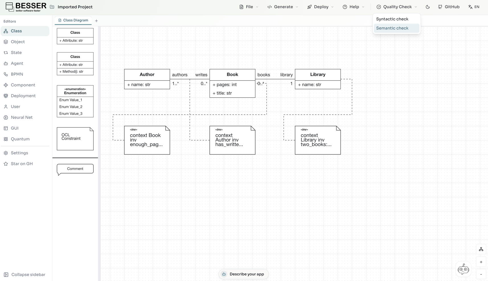
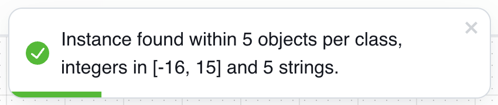
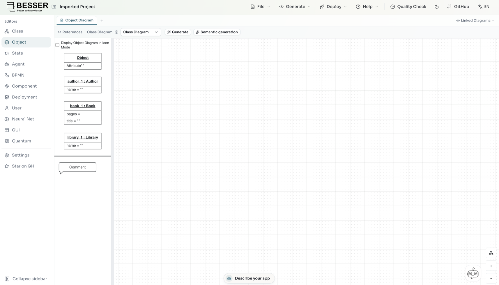
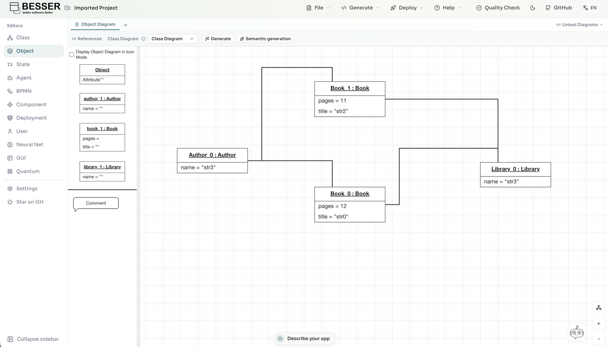
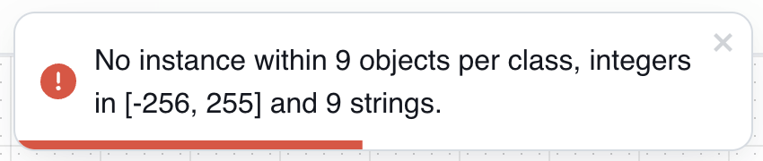
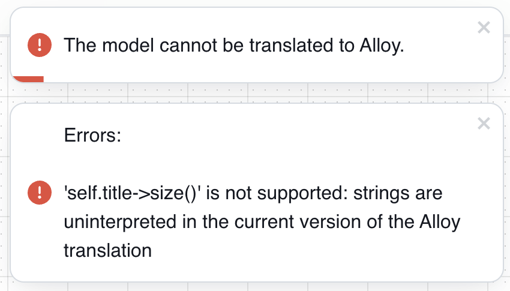

Semantic check example
======================

In this example, we verify the satisfiability of a small B-UML model with OCL invariants, and generate
an object diagram for the model that satisfies its invariants. We do it first from Python, and then
in the web editor.

The whole script is in ``docs/source/code_eg/alloy/library_semantic_check.py``. Running it needs
Java and the `Alloy Analyzer <https://alloytools.org/>`_ installed in your system (see
:doc:`../utilities/object_diagram_generator`).

The model
---------

Libraries have books, written by one or more authors. Three OCL invariants state that books have
more than 10 pages, that every library has at least two books, and that every author has written a
book:

.. literalinclude:: ../code_eg/alloy/library_semantic_check.py
   :language: python
   :start-after: # 1. The model: libraries with books, written by authors
   :end-before: # 2. The Alloy specification

The Alloy specification
-----------------------

The :doc:`Alloy generator <../generators/alloy>` translates the model and its invariants
to Alloy:

.. literalinclude:: ../code_eg/alloy/library_semantic_check.py
   :language: python
   :start-after: # 2. The Alloy specification, written to output/model.als
   :end-before: # 3. The semantic check

The ``output/model.als`` file will look as follows (abridged):

.. code-block:: alloy

    module model
    open strings

    sig Book {
      Book_pages: Int,
      Book_title: Str,
      Book_library: one Library,
      Book_authors: set Author
    }

    ...

    fact { all self:this/Book|(self.Book_pages > 10) }

    fact { all self:this/Author|(#(self.Author_writes) >= 1) }

    fact { all self:this/Library|(#(self.Library_books) >= 2) }

    pred instance_model {
      some Author
      some Book
      some Library
    }

    run instance_model for 5 Author, 5 Book, 5 Library, 5 Str, 5 Int

The ``run`` command searches for a satisfying instance. The search is bounded: up to 5 objects of each
class, 5 strings, and integers with bitwidth 5 (i.e., integers in [-16, 15]).

The semantic check
------------------

``check_consistency`` runs the Alloy Analyzer over the specification above, and ``get_scopes``
describes the bounds it searched:

.. literalinclude:: ../code_eg/alloy/library_semantic_check.py
   :language: python
   :start-after: # 3. The semantic check
   :end-before: # 4. An object diagram

.. code-block:: text

    SAT within 5 objects per class, integers in [-16, 15] and 5 strings

``SAT`` means that an instance was found: the invariants can all hold together.

The object diagram
------------------

``generate_project_file`` writes the model and an object diagram satisfying its invariants to
``output/alloy_project.py``:

.. literalinclude:: ../code_eg/alloy/library_semantic_check.py
   :language: python
   :start-after: # 4. An object diagram satisfying the invariants, written to output/alloy_project.py
   :end-before: # 5. No instance

.. code-block:: text

    SAT

To see the object diagram, import ``output/alloy_project.py`` into the web editor with **Import Project**.

When no instance is found
-------------------------

Let's add a fourth invariant, that books have fewer than 5 pages, which contradicts the first one:

.. literalinclude:: ../code_eg/alloy/library_semantic_check.py
   :language: python
   :start-after: # 5. No instance: books cannot have more than 10 and fewer than 5 pages
   :end-before: # 6. An unsupported construct

.. code-block:: text

    UNSAT within 5 objects per class, integers in [-16, 15] and 5 strings

``UNSAT`` means that no instance exists within the bounds. Note that the analysis is bounded: in
general, a larger instance might still exist (although not in this case).

When the model cannot be translated
-----------------------------------

Due to limitations in the current implementation, some B-UML and OCL constructs cannot be translated
to Alloy (see the :doc:`Alloy generator <../generators/alloy>`). In that case, an
``AlloyTranslationError`` says which one. For instance, strings have no length:

.. literalinclude:: ../code_eg/alloy/library_semantic_check.py
   :language: python
   :start-after: # 6. An unsupported construct: strings have no length in the Alloy translation

.. code-block:: text

    'self.title->size()' is not supported: strings are uninterpreted in the current version of the Alloy translation

In the web editor
-----------------

Draw the class diagram of the model, with its three OCL constraints. Then use
**Quality Check > Semantic check**:

The editor searches with 5, 7 and 9 objects per class, in turn, until it finds an instance:

To generate the object diagram, open an object diagram that references the class diagram, and click
**Semantic generation**:

The editor replaces the object diagram with the instance found:

With the contradictory fourth invariant, both actions report that there is no instance within the
largest scope, 9 objects per class. Here a scope of 5 would have been enough, since the invariants
contradict each other at any size, but the editor cannot know that and tries the larger scopes too:

With the unsupported invariant, they report that the model cannot be translated, and why:

