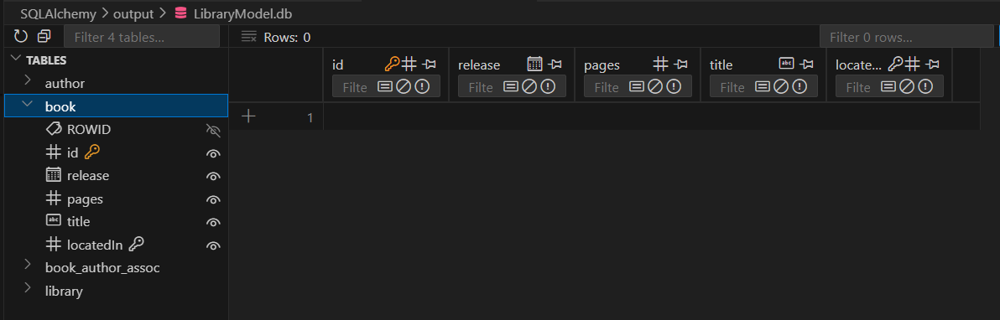

SQLAlchemy Generator
====================

BESSER provides a code generator that creates `SQLAlchemy <https://www.sqlalchemy.org/>`_ models to 
define the structure of a relational database. This structure (known as 
`Declarative Mapping <https://docs.sqlalchemy.org/en/20/orm/mapping_styles.html#orm-declarative-mapping>`_) 
defines the database metadata (using a Python object model) that will represent the input structural B-UML model.

Now, let's generate the code for SQLAlchemy of our :doc:`../examples/library_example`. 
For this, you should create the generator, provide the :doc:`../buml_language/model_types/structural`, and use 
the ``generate`` method as follows:

.. code-block:: python
    
    from besser.generators.sql_alchemy import SQLAlchemyGenerator
    
    generator: SQLAlchemyGenerator = SQLAlchemyGenerator(model=library_model)
    generator.generate(dbms="sqlite")

The ``dbms`` parameter specifies the target database management system. 
In this example, we use ``sqlite``, but you can also specify ``postgresql``, ``mysql``, ``mssql``, ``mariadb``, or ``oracle``.

Pass ``ocl_check_constraints=True`` to ``generate`` to turn the simple OCL invariants of the model
into ``CheckConstraint`` entries in each table's ``__table_args__`` (off by default). Which invariants
are translated is described in :ref:`sql-ocl-check-constraints`.

Generated Output
----------------

The ``sql_alchemy.py`` file will be generated inside the ``<<current_directory>>/output`` 
folder and it will look as follows.

.. literalinclude:: ../../../tests/BUML/metamodel/structural/library/output/sql_alchemy.py
   :language: python
   :linenos:

Trace Links
-----------

The generator records which lines of ``sql_alchemy.py`` come from which model element: after ``generate()``,
``generator.traced_files["sql_alchemy.py"].regions`` lists, for every class, enumeration and association that
has an ``id`` (as every element drawn in the web editor does), the line ranges rendered from it and the template
block that rendered them (``class``, ``enumeration``, ``association_table``, ``association_class``,
``foreign_key``, ``relationship``). Recording them does not change the generated file. ``build_generation_trace`` in
``besser.utilities.generation_trace`` turns them into a :doc:`traceability model
<../buml_language/model_types/traceability>`; the web editor shows them on its *Traceability* page.

Creating the Database
---------------------

The generated code contains the SQLAlchemy classes that represent the database metadata. If you are using SQLite as DBMS,
you can create the database and the tables by running the file as follows:

.. code-block:: bash

    python sql_alchemy.py

This will create a SQLite database named ``Librarymodel.db`` in the same directory where the file is executed. The database
looks like this:

.. note::

  Note that for DBMS different to SQLite, such as ``postgresql`` or ``mysql``, you should change the connection string in the 
  generated code, providing the necessary information to connect to the database: username, password, host, port, and database name.

.. warning::

  By default, inheritance is implemented using the `Joined Table Inheritance <https://docs.sqlalchemy.org/en/20/orm/inheritance.html#joined-table-inheritance>`_.
  Other strategies like `Concrete Table Inheritance <https://docs.sqlalchemy.org/en/20/orm/inheritance.html#concrete-table-inheritance>`_ is implemented only when you
  mark a parent class as abstract in the B-UML model, but there are limitations in Concrete inheritance, for example: the definition of relationships
  involving abstract classes are not supported. So only if the abstract class does not have relationships, it will be treated as a concrete parent class, otherwise,
  it will be treated as a parent class using Joined Table Inheritance.