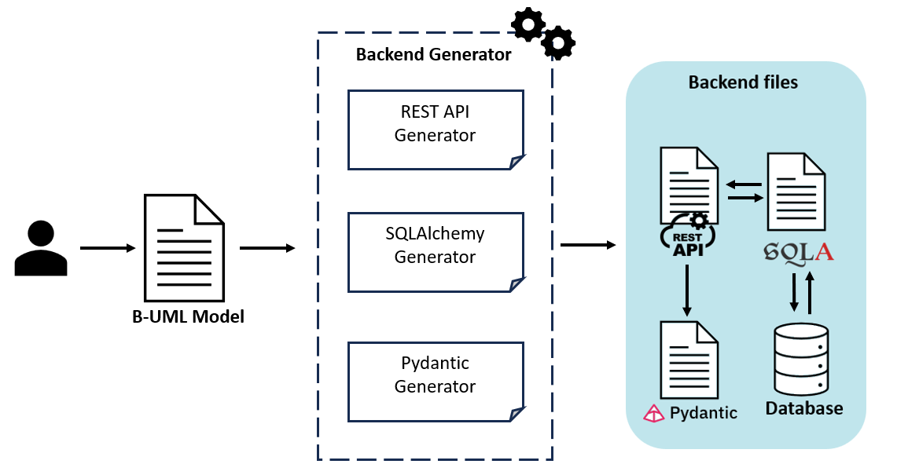

Backend Generator
=====================

BESSER provides a code generator for backend services, utilizing the FastAPI framework, SQL Alchemy for database interactions,
and Pydantic for data validation. This tool enables developers to seamlessly transform classes and relationships defined in a B-UML model 
into a fully functional backend service.

The BESSER backend generator streamlines the development process by leveraging multiple specialized generators within the BESSER suite to automatically produce:

- **A RESTful API Service**: Utilizes the BESSER REST API Generator to create dynamic, scalable API endpoints.
- **Database Models**: Integrates BESSER's SQL Alchemy Generator to construct efficient ORM-based models for database interactions.
- **Data Validation Models**: Employs BESSER's Pydantic Generator to ensure that data conforms to the defined schemas, enhancing the integrity and security of the backend.

.. seealso::
   This generator emits a fixed scaffold. If you need more than the template
   provides — JWT authentication, a Dockerfile, migrations, tests — the
   :doc:`Spec-Driven Agent <../spec_driven_agent/index>` runs *this* generator
   first and then lets an LLM customise its output to a natural-language
   request, validating and repairing the result before handing it back.

To generate the complete backend for a B-UML model, follow the steps below. The example uses the ``library`` example B-UML model as a reference.

.. code-block:: python
    
    from besser.generators.backend import BackendGenerator
    
    backend = BackendGenerator(model=library_model, http_methods=['GET', 'POST', 'PUT', 'DELETE'], nested_creations = True, docker_image = True)
    backend.generate()

You can customize the code generation patterns by selecting specific HTTP methods such as ``GET``, ``POST``, ``PUT``, and ``DELETE``.
This selection allows for targeted code generation tailored to only the necessary components of the API.
If specified in the B-UML model with read_only attributes, the generator will automatically exclude the ``PUT`` and ``DELETE`` methods.
Additionally, the ``nested_creations`` parameter configures how the API manages entity relationships in requests. If set to True, the API allows both 
the linking of existing entities via identifiers and the nested creation of new entities. If set to False, the API only permits linking existing 
entities using their identifiers. The default setting is False, which restricts the functionality to linking by identifiers. Finally, the 
``docker_image`` parameter is there to assist you in `creating a Docker image <#docker-image-generation>`_ for your application.

The ``api_title``, ``api_description`` and ``api_version`` parameters set the metadata of the generated FastAPI
application, shown in the OpenAPI docs (``/docs``) and returned by the ``/`` endpoint. They default to
``"<model name> API"``, a generic description and ``"1.0.0"``.

.. code-block:: python

    backend = BackendGenerator(
        model=library_model,
        api_title="Library Service",
        api_description="Manage libraries, books and authors.",
        api_version="2.1.0",
    )

Invoke the generate method to produce the backend code.The generated files will be placed in the ``<<current_directory>>/output_backend``.
This method will generate a modular project (rather than one large file) so each concern lives in its own module:

   + ``main_api.py``: The slim FastAPI application entry point (app setup, middleware, exception handlers, system endpoints, and one ``include_router`` per resource). It keeps its historical filename and module-level ``app`` object, so ``uvicorn main_api:app`` works unchanged.
   + ``routers/<class>.py``: One router module per class in the model, containing all of that class's CRUD, relationship and method endpoints.
   + ``database.py``: The shared engine/session setup and the ``get_db`` dependency. The database defaults to ``sqlite:///./data/<model>.db`` and can be overridden with the ``DATABASE_URL`` environment variable (shared with ``sql_alchemy.py``, so the ORM and the API always point at the same database).
   + ``bal_stdlib.py``: The B-UML Action Language standard-library helpers plus the association-class link helpers, shared by the routers.
   + ``sql_alchemy.py``: Includes SQL Alchemy database models.
   + ``pydantic_classes.py``: Consists of Pydantic validation models.
   + ``requirements.txt``: The dependencies of the generated application.

Running the application creates the SQLite database file under ``data/`` (unless ``DATABASE_URL`` points elsewhere).

Generated API tests
-------------------
With ``tests=True`` (``--option tests=true`` on the command line; off by default) the generator also writes
the tests of the API it generates, regenerated with the model like every other file:

   + ``tests/conftest.py``: a pytest fixture ``client``, a FastAPI ``TestClient`` on ``main_api.app``. It imports
     ``main_api`` once, with ``DATABASE_URL`` set to a temporary SQLite file (never the application's database),
     and drops and creates every table before each test, so each test starts from an empty database.
   + ``tests/test_generated_api.py``: one test per class that creates an object, reads it back, finds it in the
     list, updates one attribute and deletes it. The payload is derived from the model: a value of each
     attribute's type (an enumeration by literal name), the association ends the create schema requires
     (the objects they name are created first, a concrete subclass standing for an abstract class), and values
     that satisfy the OCL constraints the API enforces (comparisons, ``matches``, expressions over several
     attributes). When a related object needs at least one object of the class, the test expects the API to
     refuse the delete (409). Responses are read in both shapes, the object or ``{"<class>": object, ...}``.

A class no valid payload can be derived for gets a skipped test whose reason says why, never a failing one:
an abstract class (its subclasses' tests create it), an association class, a cycle of required association
ends (``Node -> Node`` when every node needs a parent), a constraint no generated value satisfies. A valid
model whose generated app does not run is skipped too, the reason naming the generator's limitation: a
many-to-many self association, a to-one association between a class and its parent or child, or a class with two
parent tables or two abstract bases (no mapper can be configured, so every test), and a one-to-one self
association (creating that class or a subclass). The
tests need ``pytest``, ``fastapi`` and ``httpx``; run them with ``python -m pytest`` from the backend folder or
any folder above it. ``web_app`` takes the same option for the backend it writes in ``backend/``.

.. code-block:: python

    BackendGenerator(model=library_model, output_dir="backend", tests=True).generate()
    # then: cd backend && python -m pytest -q

The REST API communicates with the database through SQLAlchemy, and Pydantic validates the data before it's sent or after it's received by the REST API.
This setup encapsulates a modern backend architecture where each piece serves a specific role in data handling and processing.
When you run the code generated, a SqlLite database and the OpenAPI specifications will be generated.

We have an example demonstrating how this generator works, which you can find here: :doc:`../examples/backend_example`.
This example showcases the usage of the Backend Generator with our :doc:`../examples/library_example` Example, illustrating its application in generating a fully functional backend from a B-UML model.

Extending the Generated Backend
-------------------------------
Every generated file starts with a line that says so, and regenerating rewrites it. Hand-written code goes
in ``extensions.py`` beside ``main_api.py`` (or in a module of that name anywhere on ``PYTHONPATH``). No
generation writes that file, ``besser build`` and ``besser regenerate`` leave it alone, and ``main_api.py``
loads it when it is there and calls two optional functions:

- ``before_routers(app)``, before the generated routers are added: a route added here wins over a generated
  route with the same method and path, so it can replace one.
- ``setup(app)``, after the generated routes: new routers, middleware, authentication, startup hooks.

.. code-block:: python

    # extensions.py
    from fastapi import APIRouter, Depends
    from sqlalchemy.orm import Session

    from database import get_db
    from sql_alchemy import Library

    router = APIRouter(prefix="/custom", tags=["Custom"])

    @router.get("/library-names")
    def library_names(database: Session = Depends(get_db)):
        return [library.name for library in database.query(Library).all()]

    def setup(app):
        app.include_router(router)

        @app.middleware("http")
        async def add_custom_header(request, call_next):
            response = await call_next(request)
            response.headers["X-Custom"] = "yes"
            return response

Start the application as before (``python main_api.py``, which reads ``PORT``, or ``uvicorn main_api:app``);
the generated ``Dockerfile`` copies ``extensions.py`` into the image when it exists.

- **Endpoints**: put them in your own ``APIRouter``, added in ``setup`` (or in ``before_routers`` to replace a
  generated route). Use ``get_db`` from ``database.py`` for a database session and the models from
  ``sql_alchemy.py`` to query it.
- **Middleware and authentication**: register them on ``app`` in ``setup`` (``app.middleware()``,
  ``app.add_middleware()``), or protect your own routes with FastAPI dependencies.
- **Configuration and secrets**: read them from environment variables (``os.environ``) instead of writing them
  into code. The generated code already reads ``DATABASE_URL`` and ``PORT`` this way. With Docker, pass them at
  run time, for example ``docker run --env-file .env ...``.

Docker Image Generation
-----------------------
The Backend Generator offers the ``docker_image`` boolean parameter, designed to streamline the creation and uploading of Docker images for the generated backend. When 
you set this parameter to *True*, you have two options for creating your image:

1. Automated DockerHub Integration
^^^^^^^^^^^^^^^^^^^^^^^^^^^^^^^^^^
Our code generator can create and upload the Docker image to your `DockerHub <https://hub.docker.com>`_ in one step. Provide a configuration file through the ``docker_config_path`` parameter, which 
enables the generator to automatically create and upload the image in your DockerHub accout using the provided configurations.
This option uses the Docker SDK for Python: ``pip install "besser[docker]"``.

To create the configuration file, use the following template and save it as a .conf file:

.. code-block:: ini
    
    [DEFAULT]
    docker_username = dockerhub_username
    docker_password = dockerhub_password
    docker_image_name = image_name
    docker_repository = dockerhub_repository
    docker_tag = image_tag
    docker_port = port

2. Custom Dockerfile Generation
^^^^^^^^^^^^^^^^^^^^^^^^^^^^^^^
The second option is to generate the Dockerfile with the instructions to create your Docker image and then run it yourself to build the image and upload it to 
your repository. To follow this option, just don't use the ``docker_config_path`` parameter in the code generator. BESSER will then assume that you will handle 
running the Dockerfile and uploading the image to the repository yourself.

The generator will create two files:

- ``Dockerfile``: Contains the necessary instructions to build the Docker image.
- ``create_docker_image.py``: A Python script that automates the process of building and uploading the Docker image.

By providing this script and the Dockerfile, users can build and upload their Docker images by executing the script with their DockerHub credentials.

.. warning::
   
   If you use the generator to generate and load the Docker image in DockerHub, you must make sure you have a Docker engine installed on your computer. 
   For example `Docker desktop <https://www.docker.com/products/docker-desktop>`_.

Generated API Endpoints
-----------------------

The Backend Generator creates a comprehensive REST API with the following endpoint categories for each entity in your B-UML model:

CRUD Operations
^^^^^^^^^^^^^^^

.. list-table::
   :header-rows: 1
   :widths: 15 35 50

   * - Method
     - Endpoint
     - Description
   * - GET
     - ``/{entity}/``
     - Get all entities (supports ``detailed=true`` for relationships)
   * - GET
     - ``/{entity}/count/``
     - Get total count of entities
   * - GET
     - ``/{entity}/paginated/``
     - Paginated list with ``skip``, ``limit``, ``detailed`` params
   * - GET
     - ``/{entity}/search/``
     - Search by attributes (auto-generated filters)
   * - GET
     - ``/{entity}/{id}/``
     - Get single entity by ID
   * - POST
     - ``/{entity}/``
     - Create single entity
   * - POST
     - ``/{entity}/bulk/``
     - Bulk create multiple entities
   * - PUT
     - ``/{entity}/{id}/``
     - Full update of entity
   * - DELETE
     - ``/{entity}/{id}/``
     - Delete single entity
   * - DELETE
     - ``/{entity}/bulk/``
     - Bulk delete by IDs

How the model shapes these endpoints:

* An **abstract class** has no endpoint that creates a record (no ``POST
  /{entity}/`` and no bulk create): records are created through the concrete
  subclasses. Its other endpoints read, change, link and delete the records of
  its subclasses.
* The **search filters** are the text, number and boolean attributes of the
  class and its parents, except derived attributes (their stored value is not
  kept up to date by the generated code) and **stored secrets**.
* The search endpoint does not filter by an attribute whose name marks a
  stored secret, since a partial match would reveal its value one character at
  a time, but every other endpoint stores and returns it like any other
  attribute: an application that stores credentials must leave them out of its
  own responses. The name of a text attribute is read as camelCase or
  snake_case words, and marks a stored secret when its last word, or the word
  before a last ``hash``, is ``password``, ``passwd``, ``pwd``,
  ``passphrase``, ``passcode``, ``secret`` or ``salt`` (``passwordHash``,
  ``clientSecret``), or when it is ``token`` alone or after ``access``,
  ``refresh``, ``auth``, ``api``, ``reset`` or ``session``
  (``refreshToken``). Any other last word keeps the filter (``passwordHint``,
  ``tokenCount``, ``inviteToken``).
* An association **from a class to itself** has a field, and for a
  many-to-many a link endpoint, for each of its two ends. The id lists of a
  many-to-many are returned as ``<target class>_ids``; when that does not tell
  two ends apart (an association to the same class, or two many-to-many
  associations to one class) each list is named after its end, ``<end>_ids``.
* When an attribute and an **association end share a name**, the association
  end is generated and the attribute is left out (model validation warns about
  the clash).
* A ``DELETE`` that would leave another record without a link it requires is
  refused with ``409`` and a message naming that record, including when the
  record is required by a part that would be deleted with its whole.

Known limits:

* An association from a class to itself carried by an association class is
  not supported (the generated app does not start serving).
* A record that is, directly or through others, one of its own parts cannot be
  deleted (``409``) until the cycle is broken. In a one-to-many from a class to
  itself that is not a composition, deleting a record whose to-one end points
  at the record itself answers ``500``; clear that end with an update first.
* With ``nested_creations=True``, a many-to-many end that carries a new object
  instead of an id answers ``500``; create the related record first and send
  its id.

.. versionchanged:: 8.0.0
   The request bodies of ``POST`` and ``PUT`` (the Pydantic ``<Class>Create``
   schemas) no longer accept fields the server owns: an attribute named ``id``
   that is not a declared primary key, the ``createdAt`` / ``updatedAt``
   timestamps, and attributes marked ``is_derived``. A declared primary key
   (``is_id=True``) is client-supplied and stays in the schema, so a model
   whose ``id`` must come from the client should mark it ``is_id``. On the
   non-owning side of a one-to-one association the schema has no field for the
   link; set it from the side that holds the foreign key. Relationship fields
   are typed after the referenced primary key rather than always ``int``.

   A ``default_value`` must be expressible as a literal of the attribute's
   type; otherwise generation raises ``InvalidDefaultValueError``. See the
   :doc:`release notes </releases/v8/v8.0.0>`.

.. _backend-response-shapes:

Response Shapes
^^^^^^^^^^^^^^^

For a class ``X`` (``x``: its name in lower case), an *object* is
``{attributes, "id", "<end>_id" per to-one end}``. ``GET /x/`` answers a list of
objects, and ``GET /x/{x_id}/`` answers the object with the ids of each to-many end
beside it:

.. code-block:: json

   {"x": {"id": 1, "name": "...", "owner_id": 4}, "pets_ids": [2, 3], "course_ids": [5]}

The key of a one-to-many end is ``"<end>_ids"``, that of a many-to-many end
``"<other class>_ids"`` (the other class's name in lower case), and that of an end
materialized by an association class ``"<end>_ids"``. A class without a to-many end
answers ``{"x": object}``.

What ``POST /x/`` and ``PUT /x/{x_id}/`` answer depends on the ``uniform_responses``
option:

.. list-table::
   :header-rows: 1
   :widths: 40 30 30

   * - Route
     - ``uniform_responses=False`` (default)
     - ``uniform_responses=True``
   * - ``POST /x/``, ``PUT /x/{x_id}/``
     - what ``GET /x/{x_id}/`` answers if ``X`` has a to-many end, else the bare object
     - what ``GET /x/{x_id}/`` answers
   * - each item of ``GET /x/paginated/?detailed=true``
     - the same split
     - what ``GET /x/{x_id}/`` answers

.. code-block:: python

    backend = BackendGenerator(model=library_model, uniform_responses=True)

Without the option, adding a to-many end to a class moves the object its ``POST``
and ``PUT`` answer from the top level to ``"x"``, so a client of the API breaks on
an unrelated model edit; with it, the object is always at ``"x"`` and a new end only
adds a key. The default is off because deployed apps and their clients read the
historical shapes; ``besser init`` turns it on for a new project
(``options = { uniform_responses = true }`` in its ``besser.toml``), and the
:doc:`full_web_app` (``web_app``) takes the same option and passes it to the backend it
writes (its React frontend reads only the status of a create or update, then the list).

The option changes nothing else: an association class is addressed by the ids of
its two ends and answers the bare link on ``GET``, ``POST`` and ``PUT`` alike;
``GET /x/`` and ``GET /x/paginated/`` without ``detailed`` answer bare objects;
``POST /x/bulk/`` answers ``{"created_count", "created_ids", "message"}``; a method
route answers ``{"method", "status", "result", "output"}`` with the class name or the
instance id; the relationship routes under ``/x/{x_id}/<end>/`` answer a message or the
related objects.

Relationship Management (N:M)
^^^^^^^^^^^^^^^^^^^^^^^^^^^^^

For many-to-many relationships, additional endpoints are generated:

.. list-table::
   :header-rows: 1
   :widths: 15 35 50

   * - Method
     - Endpoint
     - Description
   * - GET
     - ``/{entity}/{id}/{relationship}/``
     - Get all related entities
   * - POST
     - ``/{entity}/{id}/{relationship}/{related_id}/``
     - Add a relationship
   * - DELETE
     - ``/{entity}/{id}/{relationship}/{related_id}/``
     - Remove a relationship

Class Methods Endpoints
^^^^^^^^^^^^^^^^^^^^^^^

When your B-UML model includes **methods** defined on classes, the generator automatically creates API endpoints to execute them.
The generator distinguishes between two types of methods based on the method signature:

**Instance Methods** (methods with ``self``):

These methods operate on a specific entity instance. The endpoint requires an entity ID.

.. list-table::
   :header-rows: 1
   :widths: 15 35 50

   * - Method
     - Endpoint
     - Description
   * - POST
     - ``/{entity}/{id}/methods/{method_name}/``
     - Execute method on a specific entity instance

**Class Methods** (methods without ``self``):

These methods operate at the class level, performing operations on the entire collection or class-level logic.

.. list-table::
   :header-rows: 1
   :widths: 15 35 50

   * - Method
     - Endpoint
     - Description
   * - POST
     - ``/{entity}/methods/{method_name}/``
     - Execute class-level method

**Supported Parameter Types:**

The following parameter types are supported for method parameters:

- ``str`` - String values
- ``int`` - Integer values
- ``float`` - Floating-point values
- ``bool`` - Boolean values
- ``date`` - Date values
- ``datetime`` - DateTime values
- ``time`` - Time values

**Request Format:**

Parameters are passed as a JSON body:

.. code-block:: json

    {
        "params": {
            "param_name": "value",
            "another_param": 42
        }
    }

**Response Format:**

The method execution returns a structured response:

.. code-block:: json

    {
        "entity_id": 5,
        "method": "method_name",
        "status": "executed",
        "result": "...",
        "output": "captured print statements..."
    }

**Example - Instance Method:**

If your B-UML model has a ``Book`` class with a method ``apply_discount(self, percent: float)``:

.. code-block:: python

    # B-UML method definition
    def apply_discount(self, percent: float):
        self.price = self.price * (1 - percent / 100)

The generator creates:

- Endpoint: ``POST /book/5/methods/apply_discount/``
- Request body: ``{"params": {"percent": 10}}``

**Example - Class Method:**

If your B-UML model has a ``Book`` class with a method ``get_expensive_books(database, min_price: int)``:

.. code-block:: python

    # B-UML method definition (no self parameter)
    def get_expensive_books(database, min_price: int):
        return database.query(Book).filter(Book.price > min_price).all()

The generator creates:

- Endpoint: ``POST /book/methods/get_expensive_books/``
- Request body: ``{"params": {"min_price": 50}}``

.. note::

   The ``database`` parameter is automatically injected by the API framework and should not be passed in the request body.
   Any ``print()`` statements executed during method execution are captured and returned in the ``output`` field of the response.

.. _backend-nn-methods:

Methods Implemented by a Neural Network
^^^^^^^^^^^^^^^^^^^^^^^^^^^^^^^^^^^^^^^

A method whose ``implementation_type`` is ``NEURAL_NETWORK`` and whose ``neural_network`` points to an
:doc:`NN model <../buml_language/model_types/nn>` becomes a class-level endpoint that runs the network
(see :doc:`../buml_language/model_types/structural` for how to link one). The generator then also emits:

- ``neural_networks/<network>.py``: the PyTorch ``NeuralNetwork`` class, as produced by the :doc:`pytorch`.
- ``neural_networks/weights/``: where you put the trained weights, ``<network>.pt`` (a ``state_dict``
  saved with ``torch.save(model.state_dict(), ...)``). The folder's ``README.md`` lists the expected files.
- ``nn_runtime.py``: loads each network once, on first call, and runs it.
- ``torch`` in ``requirements.txt`` (and in the ``Dockerfile`` when ``docker_image=True``).

Calling the method runs the network on its parameters, in their declared order, as one input sample; the
batch dimension is added for you. A method with a single list parameter uses that list as the whole sample
(for example an image as nested lists). For a ``Patient`` class with ``score(height: float, weight: float)``:

- Endpoint: ``POST /patient/methods/score/``
- Request body: ``{"params": {"height": 1.7, "weight": 70.0}}``
- Response ``result``: ``{"network": "scorer", "output": [0.42]}``

Until the weights file exists, the endpoint answers ``503``; inputs that are not numbers, or that do not match
the network's input shape, answer ``422``. Methods with the ``NEURAL_NETWORK`` type but no linked network
answer ``501`` like any other method without an implementation.

System Endpoints
^^^^^^^^^^^^^^^^

The generated API also includes system-level endpoints:

.. list-table::
   :header-rows: 1
   :widths: 15 25 60

   * - Method
     - Endpoint
     - Description
   * - GET
     - ``/``
     - API information (name, version, status)
   * - GET
     - ``/health``
     - Health check endpoint for monitoring
   * - GET
     - ``/statistics``
     - Database statistics (entity counts)
